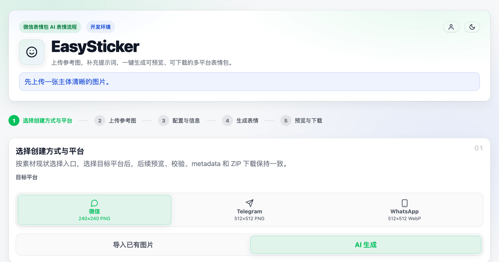
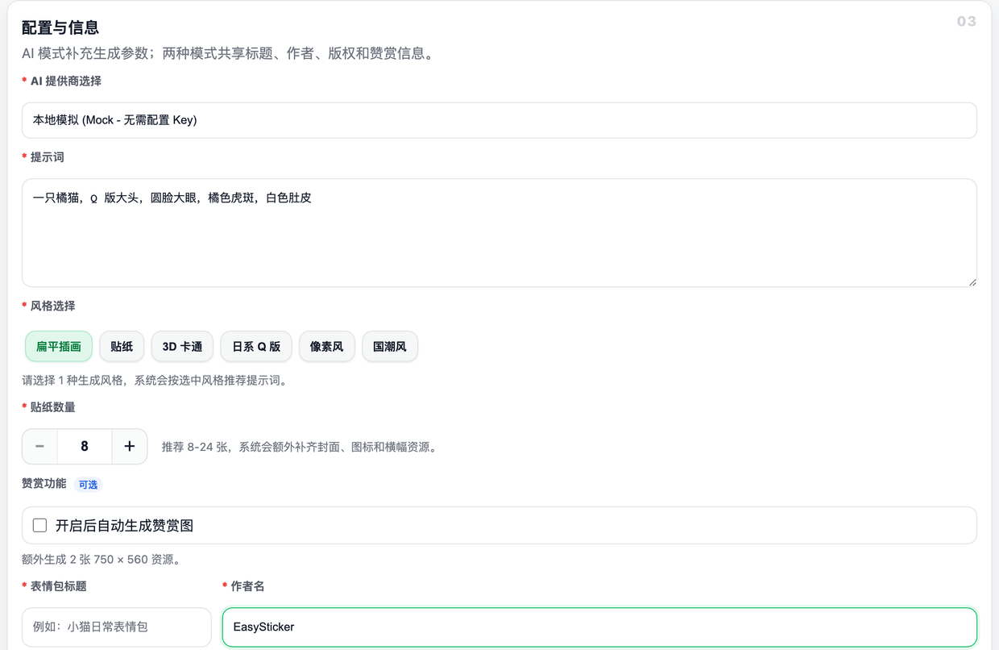
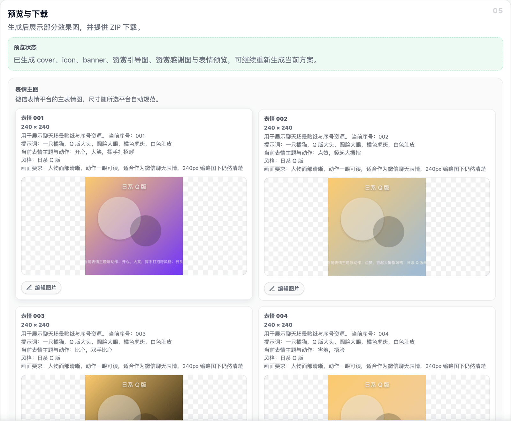

<p align="center">
  
</p>

<h1 align="center">EasySticker</h1>

<p align="center">
  <strong>表情包 AI 自动化生产线</strong><br />
  参考图 → AI 生成 / 批量导入 → 自动标准化 → 一键下载 ZIP
</p>

<p align="center">
  <a href="#快速开始">快速开始</a> ·
  <a href="#核心能力">核心能力</a> ·
  <a href="#支持平台">支持平台</a> ·
  <a href="#ai-提供商">AI 提供商</a> ·
  <a href="docs/README.md">文档中心</a> ·
  <a href="#常见问题">FAQ</a>
</p>

<p align="center">
  <a href="https://github.com/EasyIndie/EasySticker/actions/workflows/ci.yml"></a>
  <a href="https://github.com/EasyIndie/EasySticker/pkgs/container/easysticker"></a>
  <a href="https://github.com/EasyIndie/EasySticker/releases"></a>
  
  <a href="LICENSE"></a>
</p>

---

## 什么是 EasySticker

做一套表情包，通常要经历「设计 → 切图 → 调尺寸 → 补封面/图标/横幅 → 写元数据 → 校验 → 打包」。
EasySticker 把这条流水线压缩成四步：**选择平台 → 准备参考图 → 配置并生成 → 预览下载**。

它面向**自托管**场景：参考图、生成结果和运营数据都留在你自己的服务器上。后端使用
Node.js + Fastify + Sharp，前端是 Vite 构建的轻量页面，可用 Docker 一条命令启动。

| 选择创建方式与平台 | 配置提示词与风格 | 预览、编辑与下载 |
|:---:|:---:|:---:|
|  |  |  |

---

## 核心能力

**AI 生成**

- 图生图：上传角色参考图，按情绪批量生成整套表情。
- AI 生成参考图：没有现成图片时，先用文字生成参考图（文生图），再据此生成整套；也支持「主底图 + 最多 3 张附加参考图」的图生图。
- 13 种内置风格 + 13 套提示词预设，支持自定义追加或覆盖；预设可自带推荐风格与情绪集。
- 统一透明背景提示词，适配亮色 / 暗色主题。
- SSE 实时进度；单张失败可单独重生成，已成功的图不会丢。

**导入与还原**

- 批量导入 PNG / JPG / WebP / GIF，自动缩放、居中、补透明边并转换为平台规格。
- 导入本站导出的 ZIP 可读回提示词、风格、情绪、参考图与历史版本，继续编辑。
- 历史记录一键还原生成现场；已登录用户的历史按账号存服务端。

**编辑与版本**

- 任一已生成图片都能「编辑图片」：以当前图为源，只重做这一张，可再附一张参考图。
- 每次编辑或重生成都会保留旧版本，可查看并回退到任意一版。
- 历史版本随 ZIP 一起导出，重新导入不会丢。

**导出与校验**

- 按平台自动转换尺寸与格式，WebP 自动控制体积，PNG 超限自动量化。
- 结构化 ZIP：主表情 + 封面 / 图标 / 横幅 + 参考图 + `metadata.json`。
- 微信扩展资源（封面、图标、横幅、赞赏引导 / 答谢图）可勾选生成。
- 完整 OpenAPI 文档（`/docs`）。

**自托管与管理**

- 素材只存一份，ZIP 按清单现场打包，不额外落盘。
- 每 6 小时自动巡检：压缩旧包、清孤儿素材、按保留期删包（默认 30 天，不追溯既往）。
- 管理后台：实时仪表盘、统计图表、用户与存储管理、告警规则与 Webhook。
- 公网服务器 / 本地 Docker 均可部署，数据目录可直接备份迁移。

---

## 支持平台

| 平台 | 数量 | 交付规格 | 扩展资源 |
|------|------|---------|---------|
| 微信表情包 | 8–24 张 | 240 × 240 PNG | 封面 / 图标 / 横幅 / 赞赏图 |
| Telegram 静态贴纸 | 1–50 张 | ≤ 512 × 512 PNG | — |
| WhatsApp 贴纸 | 1–30 张 | 512 × 512 WebP | — |

平台差异只体现在尺寸、格式、数量与扩展资源；提示词本身是平台中立的。

---

## 快速开始

### 方式一：Docker（推荐，无需源码）

```bash
# 1. 准备 compose 文件与环境变量模板
curl -O https://raw.githubusercontent.com/EasyIndie/EasySticker/main/docker-compose.image.yml
curl -o .env https://raw.githubusercontent.com/EasyIndie/EasySticker/main/.env.example

# 2. 至少填写 API_TOKEN / JWT_SECRET / ADMIN_PASSWORD
# 3. 启动
docker compose -f docker-compose.image.yml up -d
```

打开 <http://localhost:3000/>。数据默认落在 `./data`，升级只需：

```bash
docker compose -f docker-compose.image.yml pull
docker compose -f docker-compose.image.yml up -d
```

镜像 `ghcr.io/easyindie/easysticker` 提供 `linux/amd64` 与 `linux/arm64`，
含 `:latest` 和版本 tag。锁版本可在 `.env` 中设置 `EASYSTICKER_TAG=0.3.0`。

### 方式二：源码运行

```bash
git clone https://github.com/EasyIndie/EasySticker.git
cd EasySticker
npm install
cp .env.example .env      # 本地开发可原样使用：development + Mock 模式
npm run dev               # 后端 http://localhost:3000/
npm run web:dev           # 前端 http://localhost:5173/（另开一个终端）
```

生产模式：

```bash
npm run build && npm run web:build && npm run prod
```

### 方式三：不用 AI，直接导入

启动后选择「导入已有图片」，批量上传成品图即可完成标准化、补全扩展资源和打包，
不需要配置任何 AI 提供商。

### 配置 AI 提供商

不配置也能启动，但生成结果是 Mock 本地模拟图。启用真实模型只需两步：

1. 在 `prompt-config.json` 中指定默认提供商（只写要覆盖的字段）：

   ```json
   {
     "ai": { "defaultProvider": "seedream" }
   }
   ```

2. 把密钥放进 `.env`（推荐，不要写进配置文件）：

   ```bash
   AI_SEEDREAM_API_KEY=你的密钥
   ```

命名规则为 `AI_<PROVIDER_ID>_API_KEY`，环境变量优先于配置文件。
也可以运行 `npm run setup` 交互式向导，或启动后进入**管理后台 → 设置 → AI 提供商**
可视化编辑并测试连通。

> 完整配置项、提示词模板与合并规则见 [配置参考](docs/configuration-reference.md)。

---

## AI 提供商

所有真实生图统一走 **OpenAI 兼容 Images API**，通过 `variant` 切换参数画像：

| 提供商 | 类型 / variant | 说明 | 透明底 |
|--------|----------------|------|--------|
| OpenAI gpt-image | `openai` / `gpt-image` | 文生图、图生图、文字改图全覆盖 | 原生支持 |
| 豆包 Seedream（火山方舟） | `openai` / `generic` | 国内模型，支持支付宝 / 对公付费 | 实底 |
| 任意 OpenAI 兼容端点 | `openai` / `generic` | 换 `baseUrl` / `model` 即可接入（如硅基流动 FLUX） | 视模型 |
| 本地模拟（Mock） | `mock` | 无需 Key，用于开发与功能验证 | — |

新增提供商只需在 `src/services/ai/providers/` 注册一个实现，详见
[架构设计](docs/architecture.md#6-扩展点)。

---

## 部署到公网

面向公网部署时，至少做到：

- 不要直接暴露 3000 端口，前面加一层 HTTPS 反向代理（Nginx / Caddy）。
- 固定设置 `API_TOKEN`、`JWT_SECRET`、`ADMIN_PASSWORD`。
- 反向代理下开启 `server.security.trustProxy`，让限流拿到真实 IP。
- 为 SSE 关闭代理缓冲，否则生成进度和后台实时指标会「卡住不动」。

完整的 Compose / 裸机 / 反向代理 / 升级与安全基线见 [部署指南](docs/deployment.md)。

---

## 文档

| 想了解 | 看这里 |
|--------|--------|
| 文档总览与阅读路径 | [文档中心](docs/README.md) |
| 怎么使用各项功能 | [使用手册](docs/usage.md) |
| 怎么部署上线 | [部署指南](docs/deployment.md) |
| 每个配置项 / 环境变量 | [配置参考](docs/configuration-reference.md) |
| 日志、备份、清理、排障 | [运维手册](docs/operations.md) |
| 本地开发与测试 | [开发指南](docs/development.md) |
| 代码分层与设计决策 | [架构设计](docs/architecture.md) |
| 后续演进计划 | [路线图](docs/roadmap.md) |
| ZIP 与 `metadata.json` | [包格式](docs/pack-format.md) |

---

## 常见问题

**需要自己的 AI API Key 吗？**
不需要也能启动（Mock 模式）。想要真实生成能力，配置一个 OpenAI 兼容提供商即可。

**生成的图片存在哪里？怎么清理？**
全部在服务器 `data/` 目录。素材只存一份，ZIP 不落盘。服务端每 6 小时自动巡检，
也可手动 `npm run gc`（默认只体检，`--apply` 才执行）。**不要**用按 mtime 的
`find data -delete` 清理，会删坏包。详见 [运维手册](docs/operations.md#3-存储清理与回收)。

**支持微信表情开放平台提审吗？**
输出的 ZIP 符合上架规范，可直接提交审核；目前不做自动提审。

**可以商用吗？**
代码采用 Apache-2.0，可自由使用和修改。生成图片的版权取决于底层模型服务条款。

**生成质量不满意怎么办？**
调整提示词 / 风格 / 提供商；某张不满意就单张重生成或编辑，不必整包重跑。

**很早以前导出的 ZIP 缺尺寸 / 提示词，能补回来吗？**
可以，用 `npm run repair-pack` 就地升级到最新 schema。详见
[运维手册](docs/operations.md#34-修复历史包)。

---

## License

Apache-2.0 © 2025-2026 EasySticker Contributors

<p align="center"><sub>Made with ❤️ for the sticker community</sub></p>
